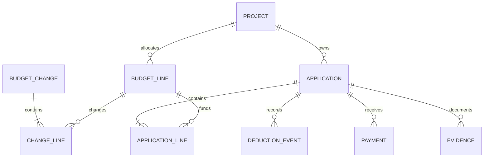

# 데이터·업무 흐름·금액 설계

2026-10-18 사용자 예산 정책을 반영한 논리 설계다. 00~02 구현과 03 이후 설계를 구분한다. [예산 정책](budget-policy.md)과 [BC-01~BC-10](07-decisions.md)이 종전 사전신청·사후청구 제안을 대체한다. 기능 구현 상태는 [진행상황](STATUS.md)을 따른다.

## 1. 데이터와 관계

| 논리 엔터티 | 주요 내용 |
|---|---|
| 사업·사업연차·재원 | 적용 기간·출처, 달력연도와 구분 |
| 프로젝트·배정 | 과제·비교과 공통, 사용자 역할 및 담당 범위 |
| 예산 분류 | 비목·세목·세세목, 내부 고유 ID·관리코드·상하위 관계·버전·적용일 |
| 예산배정항목 | 프로젝트·사업연차·재원·분류 버전·최초예산 |
| 예산변경신청·변경행 | 신청 사유·필수 첨부·전후 금액·원 항목 버전·변경행 묶음 |
| 지출 신청·신청버전·신청행 | 하나의 신청 흐름, 금액·내역·신청자·배정 업무·제출본 |
| 신청 차감·복원 이력 | 신청 시 금액 차감, 신청 전 복귀 시 효력 취소, 행위자·사유·중복처리 키 |
| 내부 승인 | 담당자 승인, 허용된 관리자 대행, 처리 사유·시각 |
| 지급·정정·환입 | 실제 지급 사실과 근거, 원 신청 연결, 복원 여부 별도 처리 |
| 증빙·파일 버전 | 비공개 저장키·해시·제출자·권한·원본 버전 |
| 처리·감사·마감 | 업무 주체와 실제 행위자, 변경 전후·사유·시각·요청 ID |

사전신청과 사후청구를 별도 필수 엔터티로 만들지 않는다. 내부 승인에 외부 공식 승인 상태·문서번호를 필수화하지 않는다. 기존 집행 건 ID는 신청·지급·정정의 연결과 중복 차감 방지에 사용한다. 01의 물리 스키마는 향후 forward migration으로 확장하고 기존 자료를 임의 삭제하지 않는다.

같은 과제의 예산항목과 지출 신청만 연결한다. 원문 분류 명칭을 임의의 하이픈으로 분해하거나 용도별 묶음 금액을 추측하여 나누지 않는다.

## 2. 신청 상태와 금액 전이

| 행위 | 조건 | 예산 효과 |
|---|---|---|
| 작성 중 저장 | 배정·작성 권한 | 차감 없음 |
| 신청 | 권한·필수 입력·잔액·버전 검사 | 신청 저장과 동시에 해당 금액 차감 |
| 신청 전 단계로 복귀 | 허용된 행위자·상태·사유 | 유효 차감 취소·잔액 복원, 원 이력 보존 |
| 재신청 | 회수·반려·취소 뒤 현재 잔액·버전 재검사 | 새 신청 버전 기준 1회 차감 |
| 보완 요청·보완 제출 | 담당자 요청·본인 보완, 금액 유지 | 신청 효력·기존 차감 유지. 재제출 추가 차감 없음 |
| 담당자 승인 | 검토·필수 자료 충족 | 내부 승인 완료, 추가 차감 없음 |
| 실제 지급 확인 | 실제 근거·금액·권한 | 지급 사실 기록, 신청 차감액과 중복 차감 금지 |

회수는 담당자 처리 전 본인 신청에 허용하며, 보완은 신청 효력·차감을 유지한다. 반려·취소는 차감을 복원하고 수정·재신청을 허용한다. 승인 후 취소는 지급 전 담당자·관리자만 가능하다. 금액 수정은 신청 전 복귀·복원 후 재신청하며 현재 잔액을 검사한다. 상세 전이표는 [예산 정책](budget-policy.md)을 따른다. 지급된 건을 일반 신청 복귀로 처리해 가용액을 무조건 복원하지 않는다. 정정·취소·환입 절차 및 D-09 확인이 선행된다. 외부 ERP 수동 처리기록의 후속 범위는 별도이며 외부 공식 승인 여부를 내부 승인 선행조건으로 두지 않는다.

## 3. 예산 계산

금액은 원 단위 bigint 또는 정확한 고정소수형으로 처리한다.

- 현재예산 = 최초예산 + 확정된 예산변경 증감 합계
- 유효 신청 차감액 = 성공한 신청별 차감액 중 적법하게 복원되지 않은 금액 합계
- 가용액 = 현재예산 - 유효 신청 차감액
- 승인·지급 여부에 관계없이 동일 신청 금액은 한 번만 차감한다.
- 지급액은 실제 지급 집계에 사용하고 위 식에 다시 빼지 않는다.

### 가상 예시

| 사건 | 현재예산 | 유효 신청 차감액 | 가용액 |
|---|---:|---:|---:|
| 시작 | 10,000,000 | 0 | 10,000,000 |
| 1,000,000원 신청 성공 | 10,000,000 | 1,000,000 | 9,000,000 |
| 다음 9,500,000원 신청 실패 | 10,000,000 | 1,000,000 | 9,000,000 |
| 첫 신청을 신청 전으로 복귀 | 10,000,000 | 0 | 10,000,000 |
| 900,000원 재신청 성공 | 10,000,000 | 900,000 | 9,100,000 |
| 동일 신청 재시도·내부 승인 | 10,000,000 | 900,000 | 9,100,000 |
| 해당 금액의 실제 지급 기록 | 10,000,000 | 900,000 | 9,100,000 |

금액 변경은 복귀·복원 후 수정·재신청 정책을 따른다. 분할 지급·환입의 상세 처리는 후속 정책에 따른다. 실제 지급 집계와 신청 차감 원장을 함께 더하거나 과거 복원 사건을 중복 적용하지 않는다.

## 4. 예산변경·권한

연구원은 본인이 담당하는 과제 전체에서 비목·세목 간 변경을 신청할 수 있다. 연구원의 과제 간 이동과 총액 증감은 금지한다. 총액 증감은 담당자만 수행한다. 담당자가 검토·최종 확정하고 관리자는 최종 확정을 대행할 수 있다. 과제책임자는 조회 전용이다.

변경 사유·전후 금액·첨부를 필수로 저장한다. 항목 간 이동은 변경행 합계 0, 같은 과제, 최신 버전을 검사한다. 이미 신청 차감·지급에 사용된 예산을 침해하는 감액은 차단한다. 변경확정·여러 변경행·감사는 하나의 트랜잭션이며 재시도는 같은 결과를 반환한다.

과제 전체 예산변경 권한을 다른 연구원의 개별 신청·증빙 열람 권한으로 확대하지 않는다. 예산 마스터 정보와 개별 업무자료의 조회 조건을 분리한다.

## 5. 파일·동시성·이력

- 예산 부족 검사·신청 저장·차감은 DB 잠금·버전·중복처리 키로 원자적으로 처리한다. 화면에 보인 잔액만 믿지 않는다.
- 기존 예산변경 양식은 파일 첨부로만 사용하며 자동 추출·화면 재현은 하지 않는다. 예산변경 첨부는 03 범위에 포함한다. 비공개 저장, 형식·크기·접근 권한 검수, 원본 버전 보존을 적용한다.
- 다른 연구원의 업무·파일·상세·검색·내보내기에 권한 조건을 공통 적용한다.
- 확정 사건을 물리 삭제하거나 원장 금액을 덮어쓰지 않는다. 정정·취소·복원 이력을 추가한다.
- Notion 프로젝트·배정 행에서 실제 배분 참고값을 확보했다. PDF와의 기준 범위·세세목 매핑·적용 기간을 대조한 뒤 실자료를 입력하며, 변경요청 금액을 중복 가산하거나 과제별 균등 배분하지 않는다.
